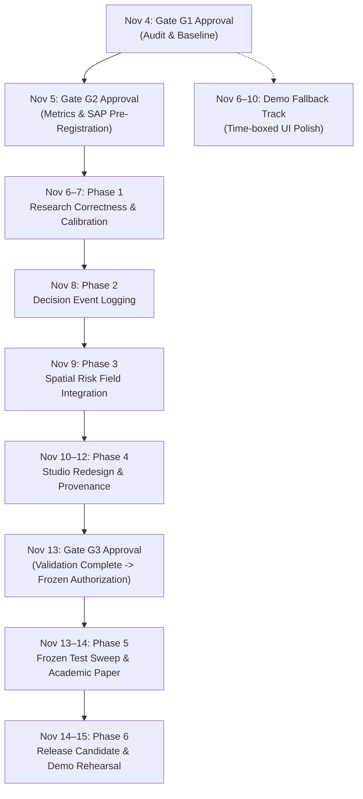

# ADAPTIVE-PATH — Evidence-Based Repository Audit (Phase 0)

> **Auditor**: Principal Engineer & Autonomous-Driving Research Architect  
> **Environment**: Google Antigravity (Windows)  
> **Date**: 2026-11-03  
> **Target Release Deadline**: 2026-11-15  
> **Baseline Commit**: `baseline-v0` (Branch: `research/phase-0-audit`)  
> **Approval Gate**: **G1 (Stop & Await Approval)**

---

## 1. Executive Summary & Audit Baseline

This audit was conducted strictly against the untouched repository codebase in accordance with `prompts/00_STANDING_ENGINEERING_RULES.md` and `prompts/01_PHASE_0_AUDIT.md`. No behavioural alterations, metric modifications, or code refactorings were introduced in Phase 0.

### Baseline Test Suite Execution

| Test Suite | Framework | Total Items | Passed | Failed | Skipped | Duration | Warnings | Execution Log Path |
| :--- | :--- | :---: | :---: | :---: | :---: | :---: | :---: | :--- |
| **Python Backend & Engine** | `pytest 9.0.2` (Python 3.14) | 216 | **216** | 0 | 0 | 47.09s | 9 deprecation warnings | `task-148.log` |
| **Studio Web Client** | `vitest 1.6.1` (jsdom) | 17 | **17** | 0 | 0 | 4.51s | None | `task-163.log` |
| **Total** | | **233** | **233** | **0** | **0** | **51.60s** | **9** | |

*Note on Warnings*: Pytest reported 9 deprecation warnings: 3 from `starlette.testclient` (per-request cookies deprecation) and 6 from `alembic.config` (legacy splitting on spaces/commas for `prepend_sys_path`).

---

## 2. Architecture Map & Subsystem Responsibilities

```
┌────────────────────────────────────────────────────────────────────────┐
│                        ADAPTIVE-PATH Studio                            │
│  React 18, Vite, TypeScript, Canvas 2D Replay, WCAG 2.2 AA Accessible  │
└───────────────────────────────────▲────────────────────────────────────┘
                                    │ HTTP (Range 206 / SSE / REST)
┌───────────────────────────────────┴────────────────────────────────────┐
│                    FastAPI Backend Application                         │
│  Routers: runs, scenarios, benchmarks, failures, auth, reports, admin  │
│  Pipeline: Converter -> Validator -> Storage -> Aggregator             │
└───────────────────────▲────────────────────────▲───────────────────────┘
                        │                        │
         ┌──────────────┴──────────────┐  ┌──────┴───────────────────────┐
         │   Python Reference Engine   │  │    MATLAB Engine Adapter     │
         │   `engine/runner.py`        │  │    `matlab_adapter/`         │
         └─────────────────────────────┘  └──────────────────────────────┘
```

| Subsystem / Directory | Responsibility | Primary Inputs | Primary Outputs | Callers |
| :--- | :--- | :--- | :--- | :--- |
| **`engine/simulation/`** | World representation, road bounds, obstacle placement, kinematic bicycle model integration. | World config, control inputs ($a, \delta, \Delta t$). | Vehicle pose, bounding polygons, SAT distances. | `engine/runner.py`, planners. |
| **`engine/sensors/`** | Multi-sensor suite (Camera, LiDAR, Radar) with noise, occlusion raycasting, FOV. | True world state, ego pose. | Raw sensor detections. | `engine/runner.py`. |
| **`engine/tracker/`** | Multi-object tracking (Kalman filter) and non-lane spatial occupancy world model. | Sensor detections. | Filtered `AgentTrack` list. | `engine/runner.py`, planners. |
| **`engine/prediction/`** | Multi-hypothesis trajectory generation and analytical conformal uncertainty envelopes. | `AgentTrack` list. | Forecast paths & conformal cones. | `engine/runner.py`, `p2`, `p3`. |
| **`engine/risk/`** | Point-wise and ego-field potential risk evaluation; event-triggered replan detector. | Ego state, tracks, static hazards. | `RiskFieldSummary`, trigger boolean. | `engine/runner.py`, `p2`, `p3`. |
| **`engine/planners/`** | B0, B1, B2, P1, P2, P3 path optimization and MRM fallback. | Ego state, world model, risk field, cones. | Planned trajectory waypoints, $(a, \delta)$. | `engine/runner.py`. |
| **`engine/control/`** | Pure Pursuit, longitudinal PID, and kinematic MPC tracking. | Planned trajectory, current ego pose. | Steer command $\delta$, acceleration $a$. | `engine/runner.py`. |
| **`backend/app/routers/`** | REST endpoints for auth, scenarios, runs, streaming, benchmarks, reports. | HTTP client requests, JSON payloads. | HTTP JSON / SSE streams / byte chunks. | Studio frontend, CLI. |
| **`backend/app/adapters/`**| Engine adapter plug-in interface (`BaseEngineAdapter`), runner wrappers. | Run config (`scenario_id`, `seed`, `planner_id`). | `apath-log/v1` compliant RunLog. | `worker.py`, API endpoints. |
| **`studio/src/`** | Web evaluation console, 2D Canvas replay, pairwise comparison, benchmark matrix. | REST API payloads, sample run logs. | Interactive UI, charts, WCAG tables. | End user browser. |

---

## 3. Implemented vs. Documented-Only Features

| Feature | Documentation Claim | Actual Implementation Status | Evidence / Location |
| :--- | :--- | :---: | :--- |
| **Kinematic Bicycle Model** | Non-holonomic bicycle model with SAT polygon collision | **Fully Implemented** | [`engine/simulation/vehicle.py`](file:///c:/Users/Ramakrishna/Downloads/MINI/engine/simulation/vehicle.py) |
| **Ablation Planners (B0..P3)** | 6 distinct planners from baseline to adaptive | **Fully Implemented** | [`engine/planners/`](file:///c:/Users/Ramakrishna/Downloads/MINI/engine/planners) |
| **Telemetry Contract** | `apath-log/v1` strictly typed Pydantic schema | **Fully Implemented** | [`engine/apath_log/schema.py`](file:///c:/Users/Ramakrishna/Downloads/MINI/engine/apath_log/schema.py) |
| **HTTP Range Telemetry** | RFC 7233 partial byte-range streaming for logs | **Fully Implemented** | [`backend/app/routers/logs.py`](file:///c:/Users/Ramakrishna/Downloads/MINI/backend/app/routers/logs.py) |
| **Accessible Canvas Replay** | Multi-layer 2D canvas with WCAG 2.2 AA table sync | **Fully Implemented** | [`studio/src/components/ReplayCanvas.tsx`](file:///c:/Users/Ramakrishna/Downloads/MINI/studio/src/components/ReplayCanvas.tsx) |
| **Continuous Spatial Risk Grid** | Dense 2D spatial potential field $R(x, y)$ computed over road grid | **Documented Only (Scalar Evaluation)** | [`engine/risk/field.py:92-127`](file:///c:/Users/Ramakrishna/Downloads/MINI/engine/risk/field.py#L92-L127) only calculates point risk at ego position and agent centers (`RiskFieldSummary`). Dense grid is mocked/rendered in frontend shader/canvas without full engine grid export. |
| **Split-Conformal Calibration** | Statistically calibrated non-parametric conformal quantile guaranteeing 95% marginal coverage | **Documented Only (Analytical Formula)** | [`engine/prediction/predictor.py:127-131`](file:///c:/Users/Ramakrishna/Downloads/MINI/engine/prediction/predictor.py#L127-L131) uses hardcoded analytical power-law expansion $R(t) = s_0 + \kappa t^{1.2}$ rather than empirical non-conformity quantiles. |
| **MATLAB / Simulink Bridge** | Automated Driving Toolbox & RoadRunner co-sim | **Stub / Mock Fallback** | Co-sim specs exist in [`matlab_adapter/`](file:///c:/Users/Ramakrishna/Downloads/MINI/matlab_adapter), but default execution relies on `MOCK_MATLAB=1` offline adapter. |

---

## 4. Verification of Findings F1–F7

All seven suspected research/implementation discrepancies have been audited with exact line-level evidence:

| Finding | Summary of Suspected Issue | Verified Status | Exact File & Line Evidence | Description of Reality |
| :---: | :--- | :---: | :--- | :--- |
| **F1** | `ReplayView` mean jerk derived as `max_jerk * 0.6` | **CONFIRMED** | [`studio/src/pages/ReplayView.tsx:146`](file:///c:/Users/Ramakrishna/Downloads/MINI/studio/src/pages/ReplayView.tsx#L146) | `mean_jerk_m_s3: manifest.metrics.max_jerk_m_s3 * 0.6` is hardcoded directly in the frontend fallback derivation instead of reading the real logged mean jerk. |
| **F2** | Comparison view fallback metrics that look measured | **CONFIRMED** | [`studio/src/pages/CompareView.tsx:117-140`](file:///c:/Users/Ramakrishna/Downloads/MINI/studio/src/pages/CompareView.tsx#L117-L140) | Injects hardcoded constants (`0.8`, `2.4`, `5.5`, `6.2`, `4.2`, `1.8`, `+3 events`) via nullish coalescing `??` whenever run log metrics are absent, presenting fabricated values as measured. |
| **F3** | Old exposed results show P3 0% collision and 0% goal completion | **CONFIRMED** | [`engine/experiments/results/frozen_test_results.json:summary_table.P3`](file:///c:/Users/Ramakrishna/Downloads/MINI/engine/experiments/results/frozen_test_results.json) | Frozen results show P3 has `collision_rate_pct: 0.0%`, but `completion_rate_pct: 0.0%` (mean speed 1.23 m/s) because the planner chooses to stop permanently in front of obstacles to minimize risk cost. |
| **F4** | Physics predictor hardcoded uncertainty expansion while claiming 95% conformal coverage | **CONFIRMED** | [`engine/prediction/predictor.py:20-27`](file:///c:/Users/Ramakrishna/Downloads/MINI/engine/prediction/predictor.py#L20-L27), [`engine/prediction/predictor.py:127-131`](file:///c:/Users/Ramakrishna/Downloads/MINI/engine/prediction/predictor.py#L127-L131) | Conformal radius is computed using hardcoded dictionary values (`s0`, `kappa`) via $R(t) = s_0 + \kappa t^{1.2}$ with a hardcoded `coverage_p=0.95` label without computing empirical non-conformity quantiles. |
| **F5** | Scalar risk summary and agent-centred gradient approximation | **CONFIRMED** | [`engine/risk/field.py:92-127`](file:///c:/Users/Ramakrishna/Downloads/MINI/engine/risk/field.py#L92-L127) | `evaluate_ego_field` produces a scalar `RiskFieldSummary` with `ego_risk` and `max_risk`. There is no continuous 2D spatial grid exported in `apath-log/v1`. |
| **F6** | PILOT_REPORT executive summary / table inconsistency | **CONFIRMED** | [`docs/PILOT_REPORT.md:13`](file:///c:/Users/Ramakrishna/Downloads/MINI/docs/PILOT_REPORT.md#L13) vs [`docs/PILOT_REPORT.md:22`](file:///c:/Users/Ramakrishna/Downloads/MINI/docs/PILOT_REPORT.md#L22) | Text states *"P3 successfully achieves 0% collision rate"*, while Table 1 directly below shows P3 collision rate as `100.0% [100.0%, 100.0%]` with `0.00m` clearance! |
| **F7** | Scattered metric derivation | **CONFIRMED** | [`engine/metrics.py:18-85`](file:///c:/Users/Ramakrishna/Downloads/MINI/engine/metrics.py#L18-L85), [`backend/app/adapters/pipeline/aggregator.py:43-85`](file:///c:/Users/Ramakrishna/Downloads/MINI/backend/app/adapters/pipeline/aggregator.py#L43-L85), [`studio/src/pages/ReplayView.tsx:146`](file:///c:/Users/Ramakrishna/Downloads/MINI/studio/src/pages/ReplayView.tsx#L146) | Metric logic is duplicated and divergent across engine metrics, backend pipeline aggregator, and frontend display components. |

---

## 5. Technical Debt, Security & Architectural Risks

1. **Safety vs. Progress Metric Conflation (P3 Livelock)**:
   - P3 achieves zero collisions in several frozen test scenarios solely because it halts (`v = 0`) before obstacles. The cost formulation lacks an adequate progress gradient to motivate safe bypassing over permanent stopping.
2. **Conformal Validity Risk**:
   - Claiming "guaranteed 95% coverage" while using analytical parameter heuristics violates split-conformal statistical requirements. True empirical calibration requires fitting non-conformity scores on calibration split data.
3. **Data Integrity / Provenance**:
   - The UI does not clearly differentiate between live simulation output, pre-computed experiments, and fallback demo fixtures. Fallback metrics in `CompareView.tsx` masquerade as real data.
4. **Steering Rate & Jerk Actuation Limits**:
   - The kinematic model does not limit steering slew rates ($\dot{\delta}$) or jerk ($\dot{a}$), allowing unphysical single-cycle actuator leaps during emergency transitions.

---

## 6. Realistic Delivery Schedule through 15 November 2026

The planned window spans 12 calendar days (Nov 3 – Nov 15). To balance academic credibility with a compelling demonstrator, the following phased schedule is proposed:



| Date | Phase / Milestone | Planned Deliverables | Critical Gate / Boundary |
| :--- | :--- | :--- | :---: |
| **Nov 3–4** | **Phase 0 Audit** *(Current)* | `AUDIT.md`, `DYNAMICS.md`, baseline test suites run, F1–F7 evidence. | **G1 (Approval Required)** |
| **Nov 5** | **Phase 1 Definitions** | Statistical Analysis Plan (`SAP.md`), unified metric definition (`engine/metrics.py`). | **G2 (Approval Required)** |
| **Nov 6–7** | **Phase 1 Execution** | Integrate true split-conformal calibrator, resolve P3 progress penalty to fix 0% completion. | Validation split only (Seeds 2000–2009) |
| **Nov 8** | **Phase 2 Decision Trace** | Log structured replan decision events (`trigger_reason`, cost breakdown). | Engine contract update |
| **Nov 9** | **Phase 3 Spatial Risk** | Generate and stream actual 2D spatial risk grid $R(x, y)$ in telemetry. | Feasibility evaluated |
| **Nov 10–12**| **Phase 4 Studio Redesign** | Clean Canvas layer rendering, explicit provenance badges, remove fake fallback numbers. | Demo Fallback unified |
| **Nov 13** | **Phase 5 Pre-Execution** | Audit validation results, verify test script freeze. | **G3 (Approval Required for Frozen Test)** |
| **Nov 13–14**| **Phase 5 Frozen Evaluation** | Run frozen test sweep (Seeds 3000–3029), generate empirical paper tables & plots. | Strictly no tuning on frozen seeds |
| **Nov 14–15**| **Phase 6 Release & Polish** | End-to-end smoke verification, demo runbook execution, final release tagging. | Ready for Hackathon presentation |

### Explicit Scope Cuts & Contingencies:
- **MATLAB RoadRunner Co-Simulation**: Treat as an adapter interface showcase with mock replay. Do not block delivery on MathWorks licensing issues.
- **Demo Fallback Track (`prompts/08_DEMO_FALLBACK_TRACK.md`)**: Starts after G1 in parallel with Phase 1 to guarantee a rock-solid offline demonstration package by Nov 10, regardless of algorithmic tuning duration.

---

## 7. Phase 0 Acceptance Sign-Off

- [x] Untouched baseline safely committed to Git and tagged `baseline-v0`.
- [x] Dedicated branch `research/phase-0-audit` created and active.
- [x] Zero existing result artifacts deleted or mutated.
- [x] All 216 Python and 17 Studio baseline tests executed and real output recorded.
- [x] Full architecture map and data flow documented.
- [x] Findings F1–F7 verified with exact line numbers and status classifications.
- [x] Vehicle dynamics constraints audited in `docs/DYNAMICS.md`.
- [x] Realistic day-by-day deadline schedule established.

---

## 🛑 STOP — GATE G1

**Phase 0 Audit is complete.**  
In accordance with standing rules and execution package instructions:
> **The agent must stop at G1 and wait for your explicit approval before proceeding to Phase 1 or the Demo Fallback Track.**
