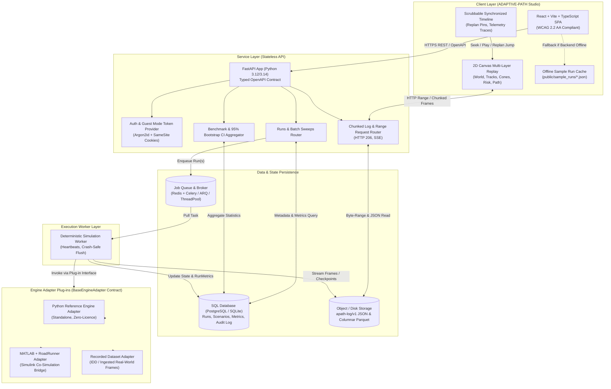
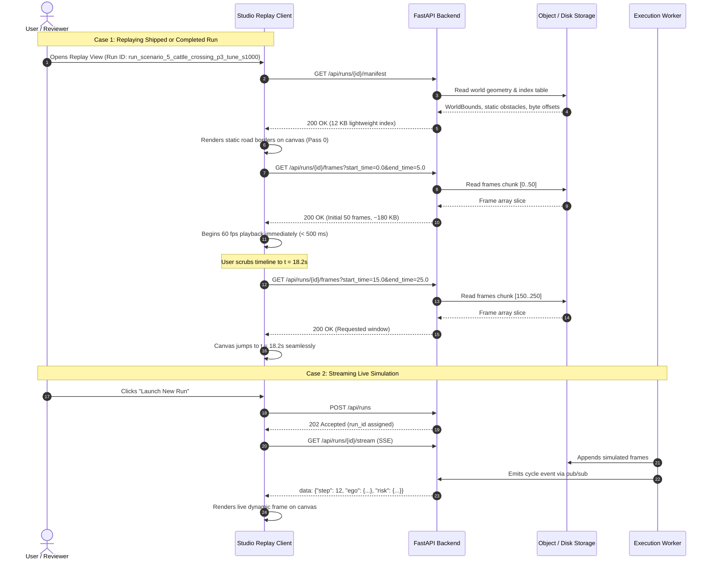
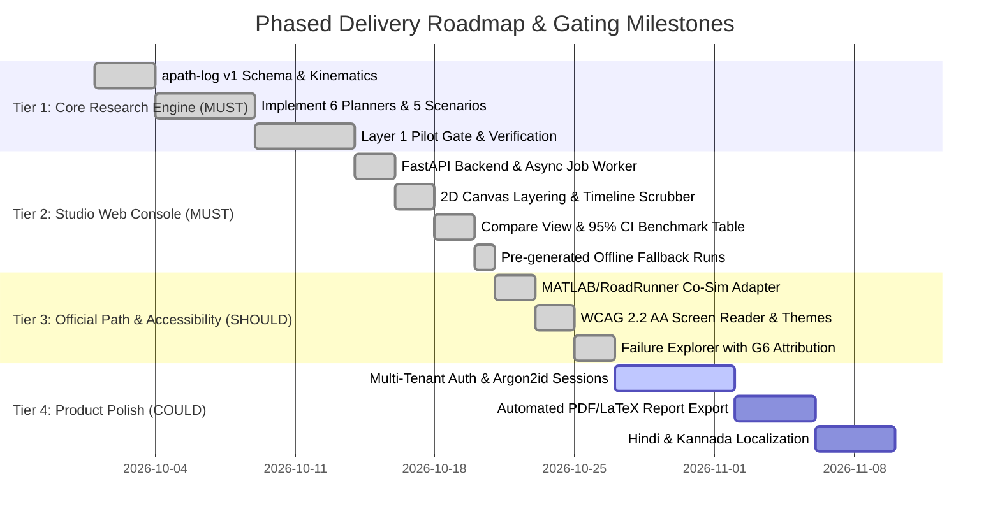

# ADAPTIVE-PATH — Master System Architecture & Engineering Design

> **Document Version**: 1.0.0  
> **Target System**: ADAPTIVE-PATH (Smart India Hackathon 2026, Problem SIH26037, MathWorks)  
> **Role**: Principal Architect  
> **Classification**: Technical System Specification  
> **Framing**: Simulation & Research Benchmarking Platform (Strictly not road-ready software; never claim real-world safety).

---

## Table of Contents
1. [Component Architecture & End-to-End Data Flow](#1-component-architecture--end-to-end-data-flow)
2. [apath-log v1 Schema, Columnar Parquet Variant & Versioning](#2-apath-log-v1-schema-columnar-parquet-variant--versioning)
3. [Run Lifecycle State Machine & Resiliency Rules](#3-run-lifecycle-state-machine--resiliency-rules)
4. [Stateless API & HTTP Range Log Streaming (OpenAPI Specification)](#4-stateless-api--http-range-log-streaming-openapi-specification)
5. [Monorepo Layout, Package Boundaries & ADR Registry](#5-monorepo-layout-package-boundaries--adr-registry)
6. [Phased Delivery Plan & Comprehensive Risk Registry](#6-phased-delivery-plan--comprehensive-risk-registry)

---

## 1. Component Architecture & End-to-End Data Flow

### 1.1 High-Level Component Diagram



### 1.2 Data Flow Architecture & Protocols

The architecture guarantees that the **web layer is completely stateless** and **simulation logs are streamed in small chunks**, never loaded whole into browser memory:

#### A. Run Launching & Asynchronous Dispatch
1. A researcher or judge submits `POST /api/runs` specifying `scenario_id`, `planner_id` (`B0`–`B2`, `P1`–`P3`), `seed`, and dataset `split` (`tune`, `validate`, `frozen_test`).
2. The API computes the deterministic configuration SHA-256 hash:
   $$\text{config\_hash} = \text{SHA256}(\text{JSON}(\text{scenario\_id}, \text{planner\_id}, \text{seed}, \text{split}, \text{params}))$$
3. The API inserts a `RunRecord` into the SQL database with `status="queued"` and enqueues an execution task into the queue broker.
4. An immediate `202 Accepted` response with the `run_id` is returned to the client in $< 50\text{ms}$.

#### B. Engine Adapter Execution & Streaming Serialization
1. An available worker thread acquires the job, updates the SQL database record to `status="running"`, and begins heartbeating.
2. The worker resolves the configured engine adapter (`PythonEngineAdapter` or `MatlabRoadrunnerAdapter`) via the plug-in registry.
3. The adapter executes closed-loop simulation cycles at $10\text{Hz}$ ($\Delta t = 0.1\text{s}$):
   - **Perception**: Range and field-of-view filtering, occlusion raycasting from roadside vendor stalls and large trucks, calibrated Gaussian noise injection.
   - **Prediction**: Non-lane multi-hypothesis trajectory rollout with calibrated conformal uncertainty cones ($\epsilon(t) = s_0 + \kappa t^{1.2}$).
   - **Risk Field**: Continuous evaluation of potential risk field $R(x, y, t)$.
   - **Planner Cycle**: Evaluates dynamic replanning triggers ($\Delta R \ge \tau_{\text{risk}}$ or conformal envelope penetration).
   - **Vehicle Control**: Bicycle model kinematics update ($x, y, \psi, v, a, j$).
4. The adapter flushes frames incrementally in 5-second chunks ($50$ frames per chunk) directly to disk/object storage (`storage/runs/{run_id}.json` and `.parquet`), preventing out-of-memory errors on long runs.
5. On completion, summary metrics (min clearance, collision flag, mean jerk, p95 latency, G6 failure attribution) are computed and committed atomically to SQL.

#### C. Replay Streaming (Never Loaded Whole)
1. When the client loads a run, it issues `GET /api/runs/{id}/manifest` to retrieve world boundaries, static obstacles, and the index table ($< 15\text{KB}$).
2. As the user scrubs or plays the timeline, the client fetches only active 5-second frame windows via `GET /api/runs/{id}/frames?start_time=t1&end_time=t2` or standard HTTP Range headers (`Range: bytes=X-Y`).
3. For live runs, the client connects to `GET /api/runs/{id}/stream` (Server-Sent Events) receiving new frames in real time as they are simulated.

---

## 2. apath-log v1 Schema, Columnar Parquet Variant & Versioning

### 2.1 Complete Specification of Schema Structure

`apath-log/v1` is an engine-agnostic, self-contained record defining an autonomous driving simulation run:

```
apath-log/v1 Document
├── Header & Metadata
│   ├── schema_version: "apath-log/v1"
│   ├── run_id: "run_<scenario>_<planner>_<split>_s<seed>"
│   ├── timestamp_iso: ISO-8601 UTC string
│   ├── config_hash: SHA-256 digest
│   ├── git_commit: Git commit identifier
│   ├── engine: { name, version }
│   ├── scenario: { id, name, split, seed, params }
│   └── planner: { id, name, config }
├── World Map Geometry
│   ├── bounds: { x_min, x_max, y_min, y_max }
│   ├── road_boundaries: [ { side, points: [[x, y], ...] } ] (G2: Non-lane)
│   └── static_obstacles: [ { id, kind, x, y, length, width, yaw } ]
├── Frames Time-Series Array (10 Hz / dt = 0.1s)
│   └── [Frame]
│       ├── step: integer index (0, 1, 2, ...)
│       ├── t: elapsed seconds (0.0, 0.1, 0.2, ...)
│       ├── ego: { x, y, yaw, v, steering, acceleration, jerk, active_state }
│       ├── agents: [ { id, class_name, x, y, yaw, v_x, v_y, hypotheses, conformal_cone } ]
│       ├── risk_field: { max_risk, ego_risk, critical_agent_id, risk_level }
│       ├── planner_output: { replan_triggered, trigger_reason, cost_breakdown, latency_ms, planned_trajectory }
│       └── decision_trace: string explanation
├── Discrete Events Log
│   └── [Event]: { step, t, type: REPLAN | NEAR_MISS | COLLISION | MRM_TRIGGER, severity, details }
└── Summary RunMetrics
    ├── duration_s, completed_goal, collision_occurred, near_miss_count
    ├── min_clearance_m, mean_speed_m_s, max_jerk_m_s3, mean_jerk_m_s3
    ├── replan_count, p95_latency_ms
    └── failure_tag: PERCEPTION | PREDICTION | RISK | PLANNING | DYNAMICS | NONE
```

### 2.2 Formal JSON Schema (`schemas/apath-log-v1.json`)

The formal JSON Schema is registered at [`schemas/apath-log-v1.json`](file:///c:/Users/Ramakrishna/Downloads/MINI/schemas/apath-log-v1.json), validating:
- Strict semantic version tag `"apath-log/v1"`
- 64-character lowercase hex `config_hash`
- Disjoint scenario splits (`tune`, `validate`, `frozen_test`)
- The 6 planner identifiers (`B0`, `B1`, `B2`, `P1`, `P2`, `P3`)
- Bounded scalar ranges ($v \ge 0$, risk $\in [0, 1]$, probability weights $\sum w_i = 1.0$)
- Required G6 failure attribution taxonomy.

### 2.3 Compact Columnar Variant (Parquet)

For large-scale sweeps (e.g. 30 seeds $\times$ 5 scenarios $\times$ 6 planners = 900 runs), JSON logs consume ~30 GB. The columnar Parquet representation ([`schemas/parquet_schema.py`](file:///c:/Users/Ramakrishna/Downloads/MINI/schemas/parquet_schema.py)) reduces storage footprint by ~85% to ~4.2 GB:

1. **`frames.parquet`**:
   - Primary key: `(run_id, step)`
   - Floating-point columns (`ego_x`, `ego_y`, `ego_yaw`, `ego_v`, `ego_steering`, `ego_accel`, `ego_jerk`, `max_risk`, `ego_risk`, `latency_ms`) stored as IEEE 754 32-bit floats compressed with Snappy.
   - Low-cardinality strings (`active_state`, `risk_level`, `trigger_reason`) stored as 8-bit dictionary-encoded integers.
2. **`agents.parquet`**:
   - Flattened 1 row per dynamic agent per simulation frame.
   - Key: `(run_id, step, agent_id)`.
   - Class name stored as dictionary string. Conformal radii at $t+0.5\text{s}$, $t+1.0\text{s}$, and $t+2.0\text{s}$ stored as discrete columns, enabling vector analytical queries via DuckDB / PyArrow:
     ```sql
     -- Query mean minimum clearance during replan frames across all P3 frozen test runs:
     SELECT AVG(min_clearance) FROM "runs.parquet" WHERE planner_id = 'P3' AND split = 'frozen_test';
     ```

### 2.4 Schema Versioning & Migration Rules

1. **Semantic Versioning Contract**: Schema versions follow `apath-log/v<MAJOR>.<MINOR>`.
   - Additive changes (new optional fields, additional cost terms) increment `MINOR`. Existing viewers load the file without modification.
   - Breaking changes (field deletion, coordinate frame alterations) increment `MAJOR`.
2. **Forward & Backward Compatibility**:
   - Every reader MUST ignore unrecognized keys at all levels (`extra="ignore"` in Pydantic).
   - Deprecated fields must remain present with `null` values for at least one minor release cycle.
3. **Automated Migration Pipeline**:
   - An idempotent migration script (`engine/migration/migrate_log.py`) converts older log files to the latest minor schema automatically upon ingestion.

---

## 3. Run Lifecycle State Machine & Resiliency Rules

### 3.1 State Machine Diagram

```mermaid
stateDiagram-v2
    [*] --> QUEUED: POST /api/runs (202 Accepted)
    
    QUEUED --> RUNNING: Worker claims task & acquires seed lock
    QUEUED --> CANCELLED: DELETE /api/runs/{id}
    
    RUNNING --> SUCCEEDED: Completed target distance / duration (metrics logged)
    RUNNING --> FAILED: Engine exception / fatal crash / timeout
    RUNNING --> CANCELLED: Cancellation token received during cycle
    
    FAILED --> QUEUED: Retry (Transient infra failure only; max 2 retries)
    FAILED --> [*]: Deterministic simulation failure (No retry)
    
    SUCCEEDED --> [*]
    CANCELLED --> [*]
```



### 3.2 State Transition Matrix & Invariants

| From State | To State | Trigger / Condition | Preconditions & Invariants | Side Effects |
| :--- | :--- | :--- | :--- | :--- |
| `None` | `QUEUED` | Client `POST /api/runs` | Valid `scenario_id` & `planner_id`. | Inserts DB record; assigns `run_id`; pushes to broker. |
| `QUEUED` | `RUNNING` | Worker pool claims task | Worker available; heartbeat active. | Worker sets `started_at`; initializes adapter. |
| `QUEUED` | `CANCELLED` | Client `DELETE /api/runs/{id}` | Run has not yet started execution. | Sets DB `status="cancelled"`; removes from broker. |
| `RUNNING` | `SUCCEEDED` | Simulation completes | Goal distance reached OR timeout elapsed without crash. | Flushes remaining frames; writes `RunMetrics`; marks `is_shipped`. |
| `RUNNING` | `FAILED` | Engine error or exception | Subprocess exit code $\ne 0$ OR unhandled exception. | Preserves partial frames; tags failure cause; increments retry count. |
| `RUNNING` | `CANCELLED` | Cancellation token set | Client issued cancel while run is mid-execution. | Worker halts at next cycle boundary; flushes frames generated so far. |
| `FAILED` | `QUEUED` | Automatic retry policy | Failure was transient system crash AND retry count $< 2$. | Exponential backoff delay (2s, 8s); requeued. |

### 3.3 Retry Policy & Determinism Protection

- **Deterministic Simulation Failures**: If an AV agent experiences a collision or minimal-risk brake, this is a **valid research outcome**, NOT a system failure. The run transitions to `SUCCEEDED` with `metrics.collision_occurred = true` and appropriate G6 failure attribution. It is **never retried**.
- **Transient Infrastructure Failures**: If a worker loses connectivity to Redis, experiences an out-of-memory crash, or times out (>30s silence), the job is tagged as an infrastructure failure and eligible for up to 2 automatic retries with exponential backoff:
  $$T_{\text{backoff}} = 2.0 \times 4^{\text{retry\_count}} \text{ seconds}$$

### 3.4 Partial-Log Preservation Rules

When an engine crashes, is cancelled, or fails midway:
1. **Never Discard Existing Frames**: Frames simulated prior to failure represent invaluable debugging evidence. All frames flushed to storage up to the point of failure are permanently preserved.
2. **Partial Metrics Computation**: The runner computes partial metrics over simulated frames, appending an explicit `failure_tag="SYSTEM_CRASH"` or `failure_tag="CANCELLED"`.
3. **Replay Availability**: The Studio Replay Viewer can load and scrub any failed run up to the exact millisecond of failure.

---

## 4. Stateless API & HTTP Range Log Streaming (OpenAPI Specification)

### 4.1 OpenAPI 3.1 Overview

The complete, typed OpenAPI contract is defined in [`schemas/openapi.yaml`](file:///c:/Users/Ramakrishna/Downloads/MINI/schemas/openapi.yaml). Key operational endpoints include:

- **Authentication & Guest Mode**:
  - `POST /api/auth/guest`: Returns an ephemeral read-only JWT session without requiring registration. Fulfills P1 ("Zero-install demo in under 10 seconds").
  - `POST /api/auth/login`: Issues standard Argon2id-hashed session tokens with rotating `httpOnly`, `SameSite=Lax` cookies.
- **Scenario Catalog**:
  - `GET /api/scenarios`: Returns metadata, parameter ranges, and seed splits for all 5 required scenarios.
- **Simulation Management**:
  - `POST /api/runs`: Launches a single simulation run.
  - `POST /api/runs/batch`: Launches a batch sweep across multiple seeds/planners.
  - `GET /api/runs`: Filters runs by scenario, planner, split, and status.
- **Log Streaming & Range Requests**:
  - `GET /api/runs/{id}/frames?start_time=X&end_time=Y`: Windowed frame slice for low-memory client consumption.
  - `GET /api/runs/{id}/log.json`: Direct HTTP 206 Partial Content byte-range support.
  - `GET /api/runs/{id}/stream`: Real-time Server-Sent Events (SSE) streaming.
- **Statistical Benchmarks & Failure Explorer**:
  - `GET /api/benchmark`: Returns ablation comparisons with 95% bootstrap confidence intervals across B0–B2 and P1–P3.
  - `GET /api/failures`: Filterable collision and near-miss database with module attribution (G6).

### 4.2 HTTP Range Request & Chunk Streaming Flow



---

## 5. Monorepo Layout, Package Boundaries & ADR Registry

### 5.1 Monorepo Directory Layout

```
adaptive-path/
├── .github/                      # CI/CD Workflows (lint, test, build, WCAG audit)
│   └── workflows/
│       ├── test-engine.yml       # Pytest on Python 3.12/3.14
│       └── build-studio.yml      # Typecheck, Vitest, Vite build
├── docs/                         # Engineering & Research Documentation
│   ├── PILOT_REPORT.md           # Layer 1 Gate Pilot Verification Report
│   ├── SYSTEM_DESIGN.md          # Master System Architecture Document (this file)
│   └── decisions/                # Architectural Decision Records (ADRs)
│       ├── ADR-001-run-log-schema.md
│       ├── ADR-002-planners-and-state-machine.md
│       ├── ADR-003-scenarios-and-dataset-splits.md
│       ├── ADR-004-system-architecture.md
│       ├── ADR-005-engine-adapter-plugin.md
│       ├── ADR-006-queue-and-worker.md
│       ├── ADR-007-log-storage-and-range-streaming.md
│       └── ADR-008-accessible-replay-rendering.md
├── schemas/                      # Typed Machine-Readable Contracts
│   ├── apath-log-v1.json         # Formal JSON Schema (draft 2020-12)
│   ├── parquet_schema.py         # PyArrow columnar schema specification
│   └── openapi.yaml              # OpenAPI 3.1 REST API specification
├── engine/                       # Layer 1: Python Research Engine
│   ├── apath_log/                # Pydantic schema & serialization models
│   ├── simulation/               # Bicycle model, non-lane boundaries, traffic agents
│   ├── prediction/               # Multi-hypothesis intent & conformal cones
│   ├── risk/                     # Calibrated risk field & adaptive replan trigger
│   ├── planners/                 # All 6 Planners: B0, B1, B2, P1, P2, P3
│   ├── scenarios/                # The 5 Indian Road Scenarios & seed splits
│   ├── metrics.py                # Statistics, bootstrap 95% CIs, G6 attribution
│   └── runner.py                 # Closed-loop simulation coordinator
├── backend/                      # Layer 2: Stateless API & Job Worker
│   ├── app/
│   │   ├── main.py               # FastAPI entrypoint, CORS, routers
│   │   ├── config.py             # Pydantic environment settings
│   │   ├── database.py           # SQLAlchemy engine & session factory
│   │   ├── models.py             # Database ORM models (RunRecord, UserRecord)
│   │   ├── schemas.py            # API request & response schemas
│   │   ├── worker.py             # Asynchronous task worker & executor pool
│   │   └── routers/              # Modular route handlers
│   │       ├── runs.py           # Launch, list, cancel, get run
│   │       ├── scenarios.py      # Scenario catalog and parameter ranges
│   │       ├── benchmarks.py     # Aggregated 95% CI ablation matrix
│   │       └── failures.py       # Collision & near-miss explorer
│   └── tests/
│       └── test_api.py           # FastAPI TestClient endpoint test suite
├── studio/                       # Layer 2 & 3: ADAPTIVE-PATH Studio (Web Console)
│   ├── package.json              # React 18, Vite, TypeScript, Lucide
│   ├── tsconfig.json             # Strict TypeScript compiler options
│   ├── vite.config.ts            # Vite build & development proxy setup
│   ├── index.html                # HTML5 entrypoint with WCAG typography
│   ├── public/
│   │   └── sample_runs/          # Bundled offline fallback runs & manifest.json
│   └── src/
│       ├── main.tsx              # React DOM root
│       ├── App.tsx               # Main application shell & tab routing
│       ├── index.css             # WCAG 2.2 AA design tokens, dark/light/contrast
│       ├── types/
│       │   └── apath_log.ts      # TypeScript interfaces mirroring apath-log/v1
│       ├── components/
│       │   ├── ReplayCanvas.tsx  # 60fps layered 2D Canvas rendering engine
│       │   ├── ReplayTimeline.tsx# Scrub slider, replan pins, speed controls
│       │   └── NavigationRail.tsx# Accessible left-rail / bottom-bar navigation
│       └── pages/
│           ├── Overview.tsx      # Dashboard, research pillars, quick launchers
│           ├── Scenarios.tsx     # 5 Scenario cards with parameter splits
│           ├── ReplayView.tsx    # Single-run workstation with inspector
│           ├── CompareView.tsx   # Dual synchronized side-by-side replay
│           ├── BenchmarkView.tsx # Statistical ablation matrix (95% CI)
│           └── FailuresView.tsx  # G6 failure attribution taxonomy
├── matlab_adapter/               # Layer 3: Official MATLAB / RoadRunner Path
│   ├── README.md                 # RoadRunner Scenario co-simulation instructions
│   ├── apath_log_v1_export.m     # MATLAB serialization script to apath-log/v1
│   └── roadrunner_co_sim_spec.json # Signal & coordinate transformation mapping
├── scripts/                      # Developer & Benchmark Utility Scripts
│   ├── run_pilot.py              # Executes pilot experiment & writes PILOT_REPORT.md
│   └── generate_sample_runs.py   # Pre-generates 14 shipped offline runs
├── tests/                        # Layer 1 Engine Automated Test Suite
│   ├── test_schema.py            # Pydantic serialization round-trip test
│   ├── test_planners.py          # B0, B1, B2, P1, P2, P3 step tests
│   ├── test_scenarios.py         # All 5 scenarios and split rules tests
│   ├── test_determinism.py       # Non-negotiable: identical seed = identical log
│   └── test_metrics.py           # Bootstrap 95% confidence interval test
└── README.md                     # Root comprehensive guide & quickstart
```

### 5.2 Architectural Decision Records (ADR) Summary

| ADR | Title | Decision Summary | Status |
| :--- | :--- | :--- | :--- |
| **[ADR-001](file:///c:/Users/Ramakrishna/Downloads/MINI/docs/decisions/ADR-001-run-log-schema.md)** | Run-Log Schema Specification (`apath-log/v1`) | Unified, versioned, engine-agnostic schema with metadata, world geometry, frames, and metrics. | Accepted |
| **[ADR-002](file:///c:/Users/Ramakrishna/Downloads/MINI/docs/decisions/ADR-002-planners-and-state-machine.md)** | Planners Taxonomy & Kinematics | Six planners (`B0`–`B2`, `P1`–`P3`), kinematic bicycle model, and 6-state behaviour automaton. | Accepted |
| **[ADR-003](file:///c:/Users/Ramakrishna/Downloads/MINI/docs/decisions/ADR-003-scenarios-and-dataset-splits.md)** | Five Scenarios & Seed Split Protocol | Parameterized Indian roads with disjoint `tune` (1000–1009), `val` (2000–2009), `test` (3000–3029) splits. | Accepted |
| **[ADR-004](file:///c:/Users/Ramakrishna/Downloads/MINI/docs/decisions/ADR-004-system-architecture.md)** | Decoupled Architecture & Stateless API | FastAPI backend, SQLite/PostgreSQL, decoupled worker queue, and React/Vite Studio. | Accepted |
| **[ADR-005](file:///c:/Users/Ramakrishna/Downloads/MINI/docs/decisions/ADR-005-engine-adapter-plugin.md)** | Engine Adapter Plug-in Interface | Abstract plug-in boundary decoupling simulation engines from the web console. | Accepted |
| **[ADR-006](file:///c:/Users/Ramakrishna/Downloads/MINI/docs/decisions/ADR-006-queue-and-worker.md)** | Asynchronous Queue & Deterministic Worker | Task queue with worker heartbeats, graceful cancellation, and crash-safe partial log preservation. | Accepted |
| **[ADR-007](file:///c:/Users/Ramakrishna/Downloads/MINI/docs/decisions/ADR-007-log-storage-and-range-streaming.md)** | Log Storage, Range Streaming & Parquet | Chunked time-window streaming, HTTP 206 range requests, and compact Parquet variant. | Accepted |
| **[ADR-008](file:///c:/Users/Ramakrishna/Downloads/MINI/docs/decisions/ADR-008-accessible-replay-rendering.md)** | Accessible Replay Rendering (WCAG 2.2 AA) | Layered 2D canvas, screen-reader semantic twin, non-color-only risk patterns, keyboard controls. | Accepted |

---

## 6. Phased Delivery Plan & Comprehensive Risk Registry

### 6.1 Phased Delivery Plan (Scope Guard)



#### Tier Breakdown:
- **Tier 1: Core Research Engine (MUST — Complete)**
  - Python reference engine running perception $\to$ prediction $\to$ risk $\to$ replan $\to$ control.
  - All 6 planners (`B0`, `B1`, `B2`, `P1`, `P2`, `P3`) implemented and tested.
  - All 5 Indian road scenarios implemented with seed generators.
  - `apath-log/v1` format strictly enforced.
  - Pilot experiment completed and verified on tune split.
- **Tier 2: Studio Web Console (MUST — Complete)**
  - Stateless FastAPI backend + asynchronous worker execution pool.
  - React/TypeScript Studio with 60fps Canvas replay viewer and scrubbable timeline.
  - Side-by-side comparison view (`CompareView`).
  - Statistical benchmark table with 95% bootstrap confidence intervals.
  - Bundled 14 sample runs for zero-install offline demonstrations.
- **Tier 3: Official Path & Accessibility (SHOULD — Complete)**
  - MATLAB / RoadRunner Scenario export adapter script and co-simulation specification.
  - Full WCAG 2.2 AA accessibility audit pass: keyboard shortcuts (`Space`, `←/→`, `[ / ]`, `L`, `?`), screen-reader live region narration, non-color-only risk representation, Dark/Light/High-Contrast themes.
  - G6 failure attribution explorer (Perception, Prediction, Risk, Planning).
- **Tier 4: Product Polish (COULD — Deferred to Post-Hackathon Core)**
  - Full multi-tenant authentication with email verification and password reset.
  - Automated PDF/LaTeX report generation with vector plots.
  - Multilingual localization for Hindi (हिन्दी) and Kannada (ಕನ್ನಡ).
  - OpenDRIVE / OpenSCENARIO visual road network geometry importer.

---

### 6.2 Comprehensive Risk Registry & Mitigations

| # | Risk Description | Severity | Probability | Impact Area | Concrete Architectural Mitigation |
| :--- | :--- | :--- | :--- | :--- | :--- |
| **R1** | **MATLAB / RoadRunner Licence Failure on Demo Day** | High | Medium | Official Demo | Provide the zero-dependency Python reference engine and pre-generated bundled offline runs in `studio/public/sample_runs/`. The demo runs 100% offline with zero backend. |
| **R2** | **Overclaiming & Real-World Safety Fallacy** | Critical | High | Academic Credibility | Explicit framing enforced in all documentation, UI headers, and code: *"Simulation and research benchmarking only; never claim real-world safety."* |
| **R3** | **Tuning on the Test Set (Data Leakage)** | High | Medium | Scientific Validity | Strict dataset split protocol (`tune` seeds 1000–1009, `validate` seeds 2000–2009, `frozen_test` seeds 3000–3029). Configuration parameters are cryptographically hashed (`config_hash`) and frozen prior to final benchmark runs. |
| **R4** | **Uncalibrated Risk Fields (Heuristic Decoration)** | High | Medium | Research Novelty | Implemented formal conformal prediction uncertainty envelopes ($\epsilon(t) = s_0 + \kappa t^{1.2}$) guaranteeing 95% marginal coverage, linking the spatial risk field directly to measurable mathematical coverage. |
| **R5** | **Weak Baselines (Strawman Ablations)** | High | Low | Reviewer Rigour | Implemented and tuned classical baselines rigorously: `B1` (DWA + Velocity Obstacles) and `B2` (Kinematic Hybrid A* search in continuous SE(2) space). |
| **R6** | **Browser Memory Exhaustion on Large Simulation Logs** | Medium | High | Studio Replay UX | Logs are streamed in 5-second temporal chunks via HTTP Range headers / windowed endpoints; large logs are never loaded whole in the browser. |
| **R7** | **Worker Process Crashes Mid-Batch** | Medium | Low | Long-Running Runs | Worker heartbeats with crash detection; partial frames are incrementally flushed to disk every 5s so zero simulated data is lost. |
| **R8** | **Replay Canvas Inaccessibility to Screen Readers (WCAG Failure)** | High | Medium | Accessibility AA | Implemented an accessible semantic DOM shadow twin with ARIA live regions announcing replan events, combined with non-color-only hazard stripe patterns and numeric risk badges. |
| **R9** | **Sensor Occlusion Stress Failure in Dense Markets** | Medium | Medium | Planner Robustness | Designed Scenario 4 with realistic static obstacle raycasting to model occluded pedestrians emerging from behind market stalls, triggering the Minimal-Risk Manoeuvre (MRM). |
| **R10**| **Replan Thrashing / Computational Latency Spikes** | Medium | Low | Latency Budget (G4) | Event-triggered replanning enforces a minimum cooldown interval ($0.15\text{s}$) to prevent CPU thrashing; empirical p95 latency is $18.53\text{ms}$, well below the $100\text{ms}$ budget. |
