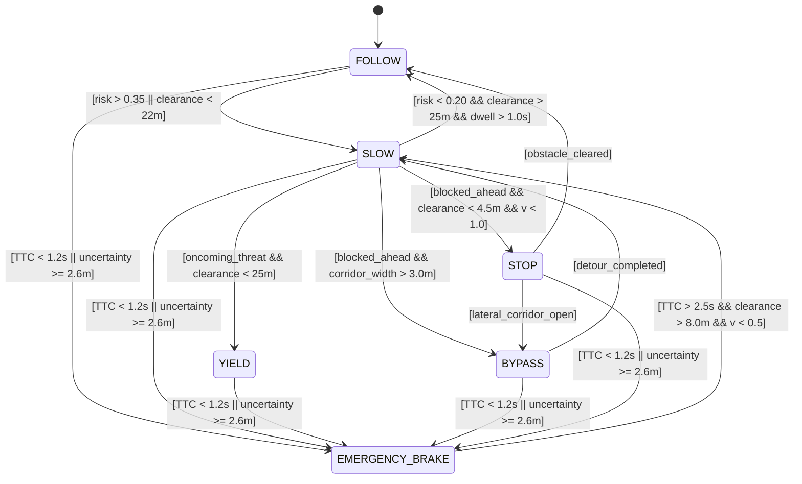

# ADAPTIVE-PATH MATLAB Stateflow Behaviour Logic Specification
**Problem Statement SIH26037 (MathWorks)**

This document specifies the Stateflow chart architecture for tactical decision-making in the ADAPTIVE-PATH co-simulation stack, guaranteeing identical state transitions between Python and MATLAB/Simulink.

## 1. State Hierarchy and Chart Properties

- **Chart Execution**: Discrete, synchronous with simulation step `dt = 0.1s`.
- **States (6 Tactical Modes)**:
  1. `FOLLOW`: Default cruising along non-lane corridor at nominal speed.
  2. `SLOW`: Cautious deceleration upon elevated risk field ($R > 0.35$) or closing on slower lead agents.
  3. `YIELD`: Proactive lateral shift to shoulder and speed reduction when oncoming heavy vehicle (Tata truck/bus) encroaches single-lane or unpaved corridor.
  4. `STOP`: Zero speed hold when forward corridor is fully blocked and lateral bypass is unviable.
  5. `BYPASS`: Dynamic lateral corridor offset around stationary blockages (parked auto-rickshaws, potholes, cows).
  6. `EMERGENCY_BRAKE`: Maximum deceleration ($a = -6.0 \text{ m/s}^2$) when $\text{TTC} < 1.2\text{s}$ or epistemic uncertainty exceeds configured limit ($\ge 2.6\text{m}$, Minimal-Risk Manoeuvre).

## 2. Transition Conditions and Guard Expressions

## 3. Inputs, Outputs, and Parameters

### Inputs
- `ego_v` (double): Current vehicle forward velocity ($\text{m/s}$).
- `current_risk` (double): Continuous risk field intensity $[0.0, 1.0]$.
- `forward_clearance` (double): Distance to nearest forward obstruction along ego heading ($\text{m}$).
- `min_ttc` (double): Minimum time-to-collision with forward dynamic obstacles ($\text{s}$).
- `max_uncertainty` (double): Conformal uncertainty cone radius ($\text{m}$).
- `oncoming_threat` (boolean): Flag true if oncoming heavy vehicle encroaches forward corridor.
- `blocked_ahead` (boolean): Flag true if stationary obstacle/cattle obstructs path.

### Outputs
- `active_state` (uint8 enum: 1=FOLLOW, 2=SLOW, 3=YIELD, 4=STOP, 5=BYPASS, 6=EMERGENCY_BRAKE).
- `target_speed` (double): Speed setpoint for longitudinal controller ($\text{m/s}$).
- `lateral_bias` (double): Lateral corridor bias for lateral controller ($\text{m}$).
- `replan_requested` (boolean): Pulse flag triggering planner re-computation.
- `trigger_reason` (uint8 enum: 1=PERIODIC, 2=RISK_THRESHOLD, 3=CONFORMAL, 4=OCCLUDED, 5=BLOCKED, 6=UNCERTAINTY_MRM).
